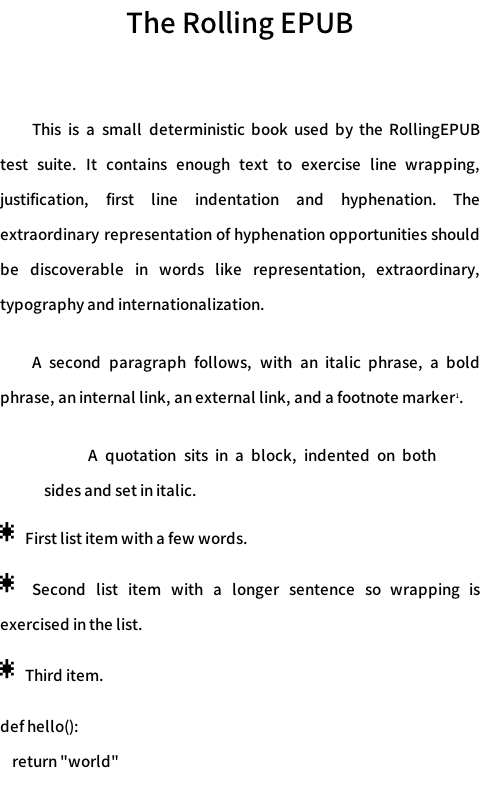
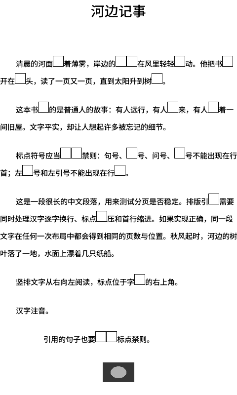

# RollingEPUB

[](https://docs.espressif.com/projects/esp-idf/)
[](https://www.arduino.cc/)

**一个可直接复用的 EPUB 解析 / 排版 / 渲染库** — 把 [CrossMux](https://github.com/0x1abin/crossmux)
与 [Read Pico](https://github.com/wegooo-cell/read-pico-reader) 两个阅读器里的 EPUB 能力
合并成一个独立库。开发者不必再实现 ZIP/OPF/NCX/NAV/HTML/CSS
解析、分页、字体栅格化或图片解码，直接调用本库即可获得：

- EPUB 2 / 3 打开、元数据、封面、目录（NCX + Nav）
- 章节 HTML/CSS 解析为可排版文本块（标题、段落、列表、表格行、图片、链接、锚点）
- 跨章节脚注（同文件 / 跨文件、文字注号 / 图标注号）与**脚注弹窗排版**
- CJK + 拉丁文混排分页、禁则、连字（hyphenation）、首行缩进、两端对齐、竖排
- 图片解码（PNG/JPEG/GIF/BMP）、缩放、**图片缩放/平移查看器**、抖动（1/2/4/8bpp）
- TrueType 字体 + 内置位图后备字体，逐段字体切换、上下标、粗斜体
- 阅读进度、章节/页码/文本偏移互相映射、TOC 跳转
- 可裁剪的编译期功能开关，适配 ESP32 等受限设备

> English summary: RollingEPUB is a portable C++17/C99-ABI EPUB engine that merges
> the EPUB stacks of CrossMux (MIT) and Read Pico (Apache-2.0). It opens a book,
> parses HTML/CSS, paginates text (CJK/Latin/vertical), decodes images and renders
> pages into the caller's framebuffer. Footnote popups, image zoom viewers, TOC,
> cover and byte-accurate progress are built in.

## 渲染效果 / Screenshots

| 拉丁文排版 | 中文排版 |
| --- | --- |
|  |  |
| **脚注弹窗** | **图片缩放查看器** |
|  |  |

以上图片由本仓库的 `repub_cli` 在测试 EPUB 上直接渲染得到。截图使用仓库自带的
`tests/fixtures/fonts/noto-subset.ttf`（子集未覆盖的字显示为方框，属于字体覆盖而非
排版问题），字体文件不随仓库分发。

## 状态 / Status

- 容器（ZIP/OPF/NCX/NAV）、HTML/CSS、分页（中/英/竖排）、渲染（1/2/4/8bpp、
  TTF、图片、抖动）、C API、C++ facade、CLI 均已实现。
- 主机测试：**8 个测试套件全部通过**（容器 15、CSS 21、Flow 16、排版 24、
  连字 6、图片 14、渲染 15、API 10，共 **121** 个用例）。
- 图片重采样：`image_scale` / `canvas_draw_image` / 缩放查看器均为**双线性**
  （放大与缩小都做插值；与 Read Pico 的看片缩放口径一致，Read Pico 缩小另用
  area 平均以保留细线，RollingEPUB 当前统一为双线性）。
- 图文混排：块级插图与正文按阅读顺序分页，支持文图同页、图片独占页、
  通栏插图与行内脚注图标；与 Read Pico 一样不实现 CSS `float` 文字环绕。
- 已验证的缩减构建：无 TTF、无图片、纯文本最小配置均可编译。
- 真实书籍样张：仓库内 17 个 EPUB（两项目测试书 + 自动生成书）全部可打开。
- 已知限制见下文「已知限制」。

## 目录 / Layout

```
include/rolling_epub/repub.h          C API（唯一必需的头文件）
include/rolling_epub/repub_config.h   编译期功能开关
include/rolling_epub/rolling_epub.hpp C++ RAII 封装（header-only）
src/                                  core / container / content / layout / render / api
third_party/                          miniz, stb_image, stb_truetype（均为宽松许可）
tools/repub_cli.cpp                   主机端 CLI：查看 / 渲染 / 导出
tests/                                单元测试 + 真实 EPUB 样本
docs/                                 架构、功能矩阵、API 指南
esp-idf/                              ESP-IDF 组件封装
```

## 快速开始（C）

```c
#include <string.h>
#include "rolling_epub/repub.h"

repub_platform_t platform = repub_platform_default();
repub_err_t err = REPUB_OK;

/* 1. 页面与排版参数 */
repub_layout_spec_t spec;
repub_layout_spec_defaults(&spec);
spec.page_rect = (repub_rect_t){ .x = 0, .y = 0, .w = 480, .h = 800 };
spec.font_size_px = 24;
spec.line_height_percent = 160;
spec.first_line_indent_em = 2;
spec.justify = 1;
spec.images_visible = 1;

/* 2. 打开并分页（内部完成 OPF/TOC/CSS/第一章解析） */
repub_reader_t *reader = repub_reader_open(&platform, "book.epub", &spec, NULL, &err);
if (!reader) { printf("open failed: %s\n", repub_err_str(err)); return 1; }

/* 3. 渲染到调用方自己的 framebuffer */
repub_canvas_t *canvas = repub_canvas_create(&platform, 480, 800,
                                             REPUB_FORMAT_GRAY4, &err);
repub_render_options_t options;
repub_render_options_defaults(&options);
options.background_level = 15; /* white */

repub_reader_render(reader, canvas, &options);
/* canvas 数据：repub_canvas_data(canvas), 灰度值 0..15，可直接推到墨水屏 */

/* 4. 翻页 / 目录 / 进度 */
repub_reader_next_page(reader);
repub_reader_goto_chapter(reader, 3);
repub_reader_goto_progress(reader, 0.5f);

/* 5. 脚注弹窗：点中注号 → 打开 → 渲染 */
int note = repub_reader_note_at(reader, touch_x, touch_y);
if (note >= 0) {
    repub_layout_spec_t popup;
    repub_layout_spec_defaults(&popup);
    popup.page_rect = (repub_rect_t){ .x = 0, .y = 0, .w = 480, .h = 500 };
    repub_note_popup_t *p = repub_reader_note_popup_open(reader, note, &popup, &err);
    repub_note_popup_render(p, 0, canvas, &options); /* 分页渲染 */
    repub_note_popup_free(p);
}

/* 6. 图片缩放：点中插图 → 打开查看器 → 设置 zoom/pan */
int img = repub_reader_image_at(reader, touch_x, touch_y);
if (img >= 0) {
    repub_image_viewer_t *v = repub_reader_image_viewer_open(reader, img, &err);
    repub_rect_t dest = { 0, 0, 480, 800 };
    repub_image_viewer_render(v, canvas, dest, 2.0f, 0.0f, 0.0f, &options);
    repub_image_viewer_free(v);
}

repub_canvas_destroy(canvas);
repub_reader_close(reader);
```

## 快速开始（C++）

```cpp
#include "rolling_epub/rolling_epub.hpp"

auto platform = repub_platform_default();
rolling_epub::LayoutSpec spec;
spec.page_rect = {0, 0, 480, 800};
spec.font_size_px = 24;

rolling_epub::Reader reader(platform, "book.epub", spec);
rolling_epub::Canvas canvas(platform, 480, 800, REPUB_FORMAT_GRAY4);

reader.render(canvas);
reader.next_page();

for (std::size_t i = 0; i < reader.page_count(); ++i)
    std::printf("page %zu starts at byte %u\n", i, reader.page_start_offset(i));
```

## 自定义字体

```c
repub_book_t *book = repub_book_open(&platform, "book.epub", NULL, &err);
repub_font_desc_t font = {
    .family = "My Serif",
    .data = ttf_bytes, .size = ttf_size, .face_index = 0,
    .style = REPUB_FONT_REGULAR,
};
repub_book_add_font(book, &font);
repub_book_set_body_font(book, "My Serif", REPUB_FONT_REGULAR);
repub_reader_t *reader = repub_reader_attach(book, &spec, &err); /* 接管 book */
```

书籍自带的 `@font-face` / 包内 TTF 在 `REPUB_ENABLE_TTF=1` 时会自动加载；
`repub_book_set_embedded_fonts(book, 0)` 可关闭。内置位图字体始终可用作后备。

## 构建

```bash
cmake -S . -B build -G Ninja -DCMAKE_BUILD_TYPE=Release
cmake --build build
ctest --test-dir build --output-on-failure
./build/repub_cli info  tests/fixtures/epub/latin.epub
./build/repub_cli render 0 --page 0 --out page.pgm tests/fixtures/epub/latin.epub
```

要求：CMake ≥ 3.20，C++17 编译器。主机端无第三方依赖（miniz/stb 已内置）。

### 裁剪构建（嵌入式）

```bash
cmake -S . -B build-small -G Ninja \
  -DREPUB_ENABLE_TTF=OFF \
  -DREPUB_ENABLE_VERTICAL_TEXT=OFF \
  -DREPUB_ENABLE_HYPHENATION=OFF \
  -DREPUB_ENABLE_GRAYSCALE=OFF \
  -DREPUB_ENABLE_IMAGES=OFF
```

也可以在项目里直接定义 `REPUB_ENABLE_*` 宏（见 `repub_config.h`），或用
ESP-IDF 的 `idf_component.yml`/`Kconfig` 覆盖。

## ESP-IDF 集成

把本仓库作为组件放入工程：

```yaml
# idf_component.yml
dependencies:
  rolling_epub:
    path: components/rolling_epub
```

或直接把仓库复制到 `components/rolling_epub/`，组件封装见 `esp-idf/`。
平台层需要提供文件读取回调（例如 FATFS/VFS），其余使用默认 malloc 即可：

```c
repub_platform_t platform = repub_platform_default();
platform.file_open  = my_open;      /* 封装 fopen("/sdcard/...") 或 VFS */
platform.file_read  = my_read;
platform.file_seek  = my_seek;
platform.file_tell  = my_tell;
platform.file_size  = my_size;
platform.file_close = my_close;
platform.allocator.alloc = psram_alloc; /* 可选：PSRAM 分配器 */
```

推荐：页面 canvas 复用静态 framebuffer（`repub_canvas_wrap`），图片/章节缓存走
PSRAM；在 ESP32-C3 级设备上关闭 TTF、竖排、连字与灰度以控制体积。

## PlatformIO / Arduino

根目录提供 `library.json` 与 `library.properties`：

```ini
lib_deps = RollingEPUB
```

Arduino 侧可使用 C API，或 `rolling_epub.hpp`（需要 C++17）。

## 功能开关

见 [`docs/FEATURES.md`](docs/FEATURES.md) 的完整矩阵与开关表。默认全功能构建；
`REPUB_ENABLE_TTF`、`REPUB_ENABLE_VERTICAL_TEXT`、`REPUB_ENABLE_HYPHENATION`、
`REPUB_ENABLE_IMAGES`、`REPUB_ENABLE_GRAYSCALE` 是最值得裁剪的几项。

## 文档

- [`docs/PLAN.md`](docs/PLAN.md) — 架构、模块边界、复用来源
- [`docs/FEATURES.md`](docs/FEATURES.md) — 两个源项目与 RollingEPUB 的功能对照
- [`docs/API.md`](docs/API.md) — API 指南（生命周期、坐标、内存、错误处理）
- [`docs/PORTING.md`](docs/PORTING.md) — 从 CrossMux / Read Pico 迁移
- [`docs/LICENSING.md`](docs/LICENSING.md) — 许可证与来源声明

## 已知限制 / Known limitations (v1)

1. **可见连字符**：英文自动断词保持原文连续（不丢字），但不会额外绘制 `-`
   字形；需要时可扩展 page display list（当前 `repub_span_t` 只引用章节原文）。
2. **ruby**：保留基字、丢弃 `<rt>` 注音（需要注音渲染时可后续加字段）。
3. **表格**：按行展开为文本（单元格用两个空格分隔），不绘制网格线。
4. **段落左右外边距**：`FlowBlock` 目前只有 before/after/indent；blockquote 使用
   2em 默认内缩，其他块级元素的 `margin-left/right` 不能精确表达。
5. **分页缓存**：仅内存缓存，不写磁盘；超大章节一次性分页（无增量/断点续排）。
6. **竖排**：图片独占一页；段后距在竖排中未应用；个别标点旋转依赖字体。
7. **DRM**：只识别 `META-INF/encryption.xml` 与加密 ZIP 条目并返回
   `REPUB_ERR_PROTECTED`，不提供解密。
8. **固定版式 / MathML / SVG / 脚本 / 网络资源**：不支持（见 FEATURES.md）。
9. **Windows 路径**：默认平台用 UTF-8 → UTF-16 打开文件，支持中文书名路径；
   自定义平台回调需自行处理编码。
10. **生命周期**：`repub_note_popup_t` / `repub_image_viewer_t` 持有 reader 内部
    指针，必须先释放它们再 `repub_reader_close`。
11. **零值语义**：`layout_spec` 中数值 0 表示“库默认值”（如 hyphenation=0 会退回
    默认开启）；如需关闭某项请显式设置 `REPUB_ENABLE_*` 编译开关或后续版本会加入
    “显式关闭”标志。

## 许可证

RollingEPUB 采用 **MIT**。代码来源与第三方组件（CrossMux MIT、Read Pico
Apache-2.0、miniz MIT、stb public domain）的版权声明见 [`NOTICE`](NOTICE) 与
[`licenses/`](licenses/)。仅复用了 Read Pico 中标记为 Apache-2.0 的文件；未使用
`LicenseRef-Kiikoread-Personal-Study-1.0` 的代码。
